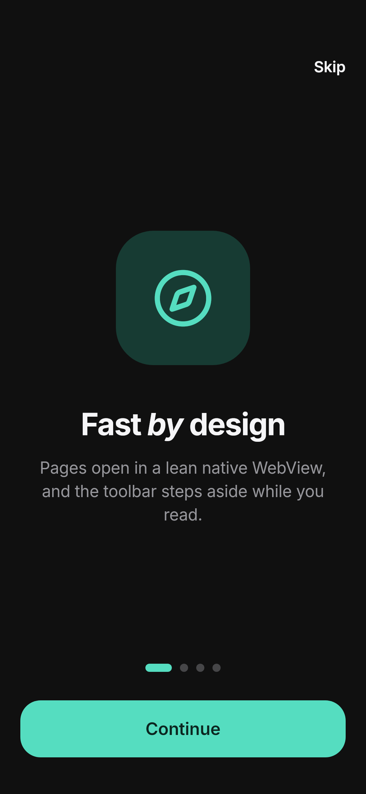
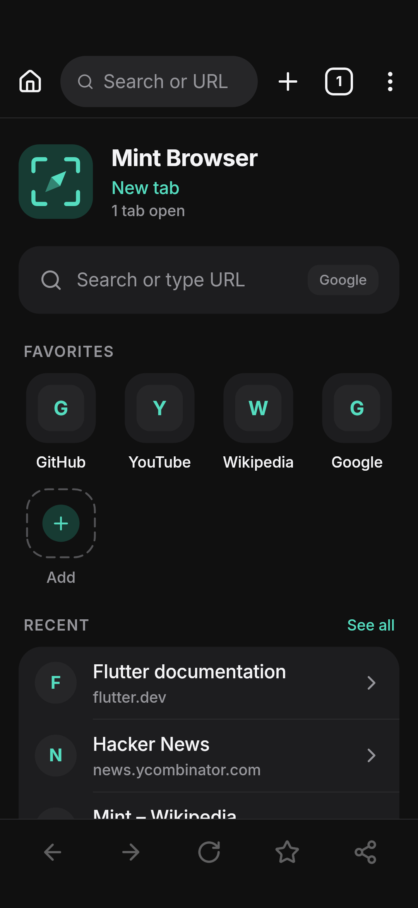
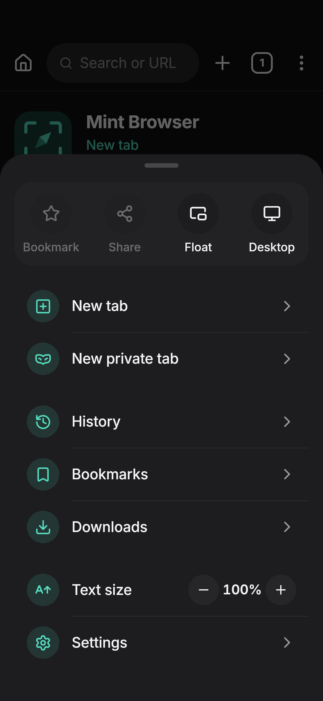
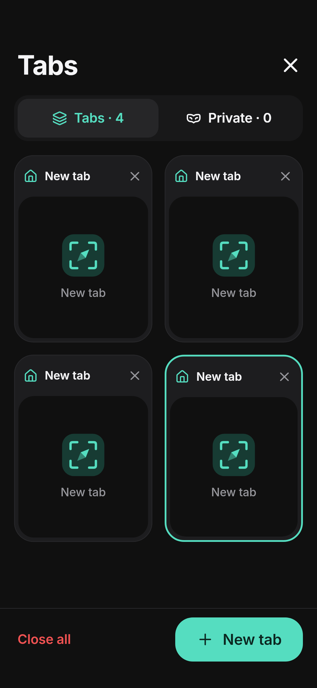
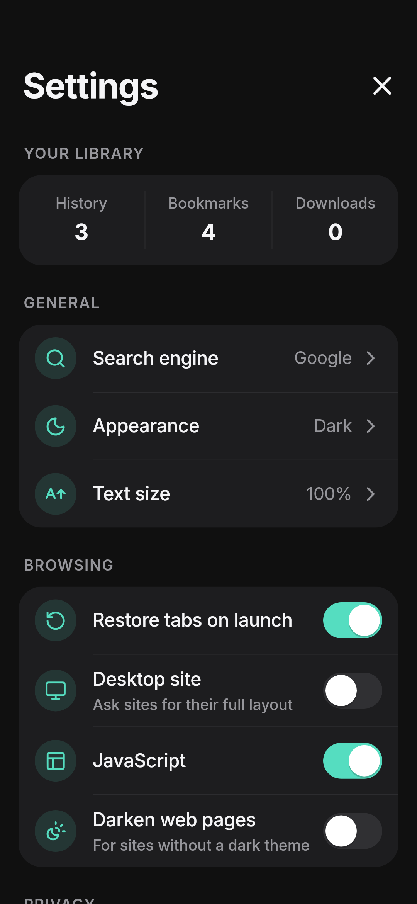
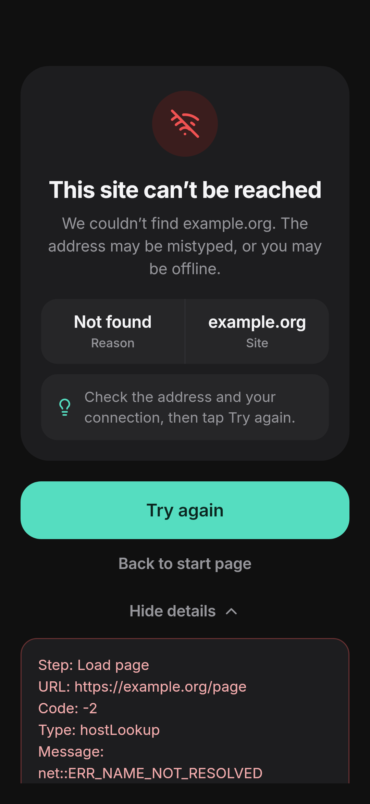
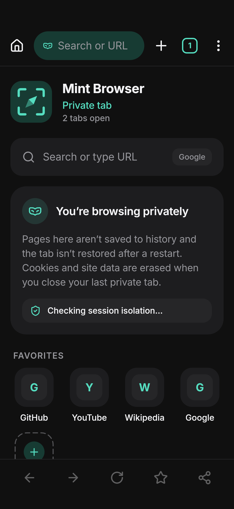
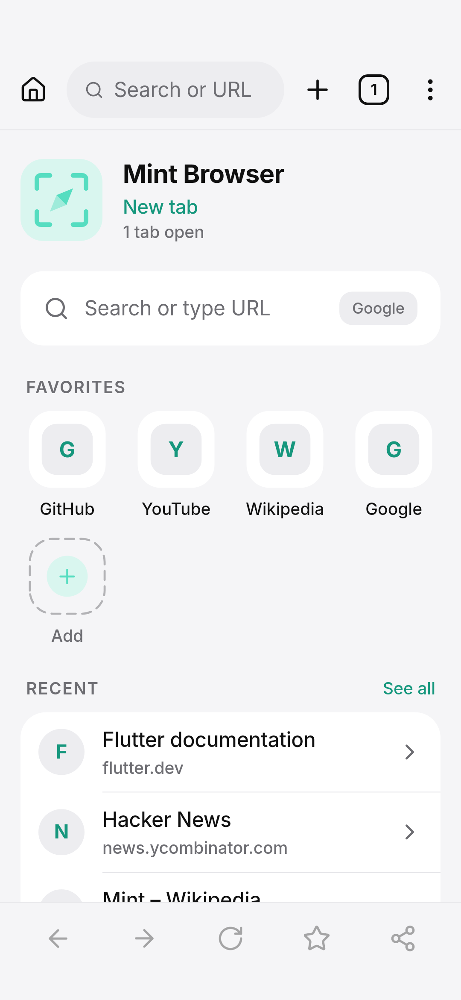

# Mint Browser

Browser Android berbasis Flutter dengan UI gelap minimalis (hitam/charcoal + aksen mint `#55DDC0`), animasi bergaya iOS, dan fitur browser yang benar‑benar bekerja di atas **Android System WebView**.

## Tampilan

| Onboarding | Tab baru | Menu | Tab |
| --- | --- | --- | --- |
|  |  |  |  |
| **Settings** | **Error** | **Tab privat** | **Mode terang** |
|  |  |  |  |

Dirender dengan `flutter test --tags screenshots --run-skipped --update-goldens test/screenshots` (font Inter & Lucide asli, 360×780 dp).

## Fitur

| Fitur | Implementasi |
| --- | --- |
| Address bar (URL & kata kunci) | `SearchScreen` + `UrlUtils.resolve` — mendeteksi URL/IP/localhost, selain itu dicari dengan mesin pencari terpilih, saran dari bookmark & riwayat |
| Multi‑tab + ringkasan tab | `tabsProvider`, `TabsScreen` (grid responsif, preview screenshot, swipe/✕ untuk menutup, Hero ke halaman) |
| Back / Forward / Refresh / Stop / Home | `BottomToolbar` + `WebEngine` |
| Bookmark & Favorit | `bookmarksProvider`; favorit tampil sebagai tile di tab baru, bisa ditambah/ubah nama/dihapus |
| Riwayat | `historyProvider` — disimpan **terenkripsi** (flutter_secure_storage / Android Keystore), dikelompokkan per hari, pencarian, hapus per item / semua |
| Download manager | Android `DownloadManager` lewat `Downloads.kt` (cookie & user‑agent halaman ikut dikirim), progres live, buka / batalkan / hapus file |
| Mode gelap & terang | Tema Dark / Light / System, opsi *Darken web pages* (algorithmic darkening WebView) |
| Mesin pencari | Google, DuckDuckGo, Bing, Brave, Startpage, Ecosia, atau URL kustom dengan `%s` |
| Sesi & cookie normal | CookieManager bawaan WebView, di‑flush saat aplikasi di‑pause |
| Floating window | `FloatingWindowService.kt` — jendela mini di atas aplikasi lain: geser, ubah ukuran, minimize ke bubble, maximize/restore, buka di aplikasi, tutup |
| Pulihkan tab terakhir | Tab normal disimpan & dipulihkan saat start; *Reopen closed tab* + *Undo* saat menutup tab |
| Privasi | Simpan riwayat on/off, blokir cookie pihak ketiga, izin situs, backup Android dinonaktifkan |
| Hapus cache & data | Riwayat, cookie & data situs, cache, daftar download, izin situs |
| Private browsing | Tab privat memakai **profil WebView terpisah** (androidx.webkit multi‑profile, WebView 110+): cookie/storage terpisah dan dihapus saat tab privat terakhir ditutup. Tidak masuk riwayat, tidak dipulihkan. Pada WebView lama, aplikasi memberi tahu bahwa isolasi cookie tidak tersedia |
| Ukuran teks & tampilan | Text zoom 50–200 %, mode situs desktop, JavaScript on/off |
| Izin situs | Kamera, mikrofon, lokasi: Ask/Block default + pilihan per situs; izin runtime Android diminta saat dibutuhkan |
| Share URL | `share_plus` |
| Halaman error + retry | `PageErrorView` — ikon besar, alasan & situs, tips, *Try again*, detail yang bisa dibuka & disalin |
| Progress loading | Garis mint tipis di bawah toolbar |
| Splash & onboarding | Splash native (Android 12 SplashScreen API) + splash Flutter beranimasi, onboarding 4 halaman |
| Lainnya | Bisa dijadikan browser default (intent filter http/https + RoleManager), menerima link yang dibagikan, link `tel:`/`mailto:`/`intent:` diteruskan ke aplikasi terkait, file upload `<input type=file>`, dialog JS alert/confirm/prompt |

## Struktur

```
lib/
  main.dart, app.dart, router.dart     bootstrap, tema, GoRouter + transisi
  core/          theme (warna, tipografi Inter), motion, utils, platform (MethodChannel)
  data/          model + storage (SharedPreferences, secure vault)
  state/         provider Riverpod (settings, tabs, bookmarks, history, downloads, izin)
  features/      splash, onboarding, browser (engine WebView, toolbar, menu, error),
                 tabs, settings, history, bookmarks, downloads, floating
  widgets/       komponen desain: tombol, kartu grup, switch, segmented, field, sheet,
                 dialog, toast, status view, logo
android/app/src/main/kotlin/…/mint_browser/
  MainActivity.kt          channel mint/app & mint/floating, intent, izin, file picker
  WebHooks.kt              profil privat, cookie pihak ketiga, darkening, download, thumbnail
  Downloads.kt             DownloadManager
  FloatingWindowService.kt jendela mengambang (overlay)
```

## Prasyarat

- Flutter stable **3.47.x** (Dart 3.13)
- JDK 17
- Android SDK (compileSdk 36, minSdk 24)

## Menjalankan

```bash
cd MINTBROWSER
flutter pub get
flutter run            # perangkat/emulator Android
flutter analyze
flutter test           # unit + widget test
```

## Build APK / AAB

```bash
flutter build apk --release            # build/app/outputs/flutter-apk/app-release.apk
flutter build apk --release --split-per-abi   # APK lebih kecil per arsitektur
flutter build appbundle --release      # build/app/outputs/bundle/release/app-release.aab
```

Workflow GitHub Actions [`.github/workflows/mint-browser.yml`](../.github/workflows/mint-browser.yml) menjalankan analyze, test, lalu membangun APK & AAB dan mengunggahnya sebagai artifact `mint-browser-release`.

## Release signing

1. Buat upload key:
   ```bash
   keytool -genkey -v -keystore ~/mint-upload.jks -keyalg RSA -keysize 2048 -validity 10000 -alias upload
   ```
2. Lokal: buat `android/key.properties` (sudah di‑`.gitignore`):
   ```properties
   storeFile=/home/kamu/mint-upload.jks
   storePassword=…
   keyAlias=upload
   keyPassword=…
   ```
3. CI: isi secret repositori `MINT_KEYSTORE_BASE64` (`base64 -w0 mint-upload.jks`), `MINT_KEYSTORE_PASSWORD`, `MINT_KEY_ALIAS`, `MINT_KEY_PASSWORD`.

Tanpa konfigurasi ini, build release ditandatangani dengan debug key (untuk uji coba saja).

## Persiapan Google Play

- `applicationId`: `com.botbuilf.mintbrowser`; versi dari `pubspec.yaml` (`version: 1.0.0+1`).
- targetSdk mengikuti Flutter (36), R8 minify + shrink resources aktif.
- Ikon toko 512×512: [`docs/store/icon-512.png`](docs/store/icon-512.png). Ikon adaptif + monokrom (themed icon) tersedia.
- **Foreground service `specialUse`** (floating window): di Play Console isi deklarasi *Foreground service* dengan alasan “menjaga jendela browser mengambang yang dibuka pengguna tetap tampil di atas aplikasi lain”, dan sertakan video singkat.
- **SYSTEM_ALERT_WINDOW**: hanya diminta saat pengguna membuka floating window, dengan penjelasan di dalam aplikasi.
- **Kamera / mikrofon / lokasi**: hanya diminta ketika situs memintanya dan pengguna mengizinkan. Cantumkan di formulir Data safety; aplikasi tidak mengirim data ke server sendiri (tidak ada backend).
- Data safety: riwayat, bookmark, dan pengaturan hanya disimpan di perangkat; backup Android dimatikan (`allowBackup=false`, `data_extraction_rules.xml`).
- Sediakan URL kebijakan privasi sebelum rilis.

## Catatan teknis

- WebView: `webview_flutter` + `webview_flutter_android` (Texture Layer Hybrid Composition). Hook native memakai `WebViewFlutterAndroidExternalApi` untuk mengakses `WebView` asli.
- Maksimal 5 WebView hidup sekaligus; tab latar yang lebih lama dilepas untuk menghemat RAM dan dimuat ulang dari URL tersimpan ketika dibuka.
- Toolbar atas & bawah menyusut saat halaman di‑scroll ke bawah dan muncul kembali saat scroll ke atas, saat loading, atau di halaman error.
- Floating window tidak tersedia untuk tab privat (agar sesi privat tetap terpisah).
- Font Inter (SIL OFL 1.1) disertakan di `assets/fonts`; ikon dari Lucide.
